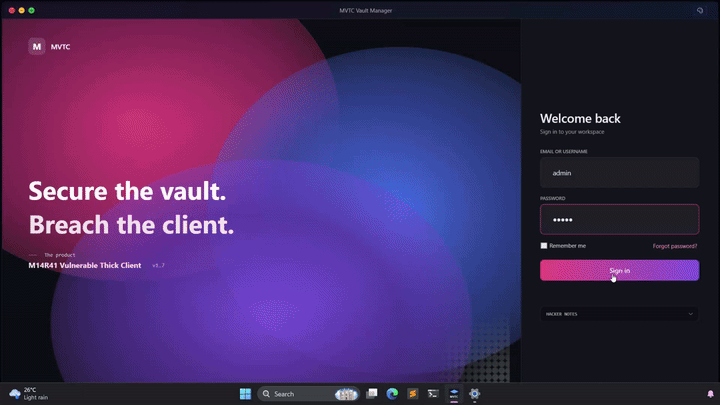

# M14R41 Vulnerable Thick Client (MVTC)

MVTC is an intentionally vulnerable Windows thick-client application built as a hands-on CTF lab for learning thick-client pentesting and defensive detection engineering. It ships with **51 planted vulnerabilities** across 11 categories, each wired to a built-in challenge, flag, and local scoreboard.


---

## Quick start

**Default credentials:** `m14r41` / `test@123` (pre-filled on the login screen).

Three other accounts (`admin`, `auditor`, `svc_backup`) are seeded but their credentials are *not* published — discover them during the assessment.

**Install options:**

| | MSI | Portable EXE |
|---|---|---|
| **Download** | **[MVTC-v1.7.4.msi](https://github.com/m14r41/m14r41-vulnerable-thick-client/releases/download/v1.7.4/MVTC-v1.7.4.msi)** (101.6 MB) | **[MVTC-v1.8.exe](https://github.com/m14r41/m14r41-vulnerable-thick-client/releases/download/v1.8/MVTC-v1.8.exe)** (153.4 MB) |
| Version | 1.7.4 (older release) | **1.8 (latest)** |
| Install needed | Yes (to `Program Files`) | No, just run |
| Vault service (`MVTCVaultSvc`) | Yes | No |
| Admin rights required | Yes | No |
| Challenges reachable | 50 (no #20 shellcode yet) | **All 51** |

Latest assets: [v1.8 release page](https://github.com/m14r41/m14r41-vulnerable-thick-client/releases/tag/v1.8) · older MSI on the [v1.7.4 release page](https://github.com/m14r41/m14r41-vulnerable-thick-client/releases/tag/v1.7.4).

---

## Demo

<p align="center">
  <em>MVTA - Vulnerable Thick Client Demo</em>
</p>
<p align="left">
  
</p>


----

## Challenge inventory (51 total · 4,800 points)

### Install / Service misconfigurations (9 · 790 pts)

| # | Challenge | CWE | Tier | Pts |
|--:|:---|:---|:---|--:|
| 1 | DLL hijacking / search-order & sideloading | CWE-427 | MEDIUM | 90 |
| 2 | Unquoted service path | CWE-428 | MEDIUM | 90 |
| 3 | Weak service / file / registry ACLs | CWE-732 | EASY | 70 |
| 4 | Writable install directory | CWE-732 | EASY | 50 |
| 5 | Missing binary protections | CWE-693 | EASY | 50 |
| 6 | Token / privilege misuse (SYSTEM svc) | CWE-269 | HARD | 150 |
| 7 | DLL preloading from PATH / SxS | CWE-427 | MEDIUM | 100 |
| 8 | Writable persistence (Run key / Startup) | CWE-732 | EASY | 50 |
| 9 | Insecure COM / DCOM exposure | CWE-284 | HARD | 140 |

### Logic privilege escalation (3 · 270 pts)

| # | Challenge | CWE | Tier | Pts |
|--:|:---|:---|:---|--:|
| 10 | Privesc via registry role flip | CWE-250 | EASY | 60 |
| 11 | Client-side authorization bypass | CWE-602 | EASY | 60 |
| 12 | TOCTOU on privileged file op | CWE-367 | HARD | 150 |

### Process / runtime injection (8 · 910 pts)

| # | Challenge | CWE | Tier | Pts |
|--:|:---|:---|:---|--:|
| 13 | CreateRemoteThread + LoadLibrary | CWE-114 | MEDIUM | 100 |
| 14 | APC injection (QueueUserAPC) | CWE-114 | MEDIUM | 100 |
| 15 | Process hollowing | CWE-114 | HARD | 140 |
| 16 | Reflective / manual-map DLL | CWE-114 | HARD | 150 |
| 17 | .NET Assembly.Load / AppDomain | CWE-470 | MEDIUM | 100 |
| 18 | Thread hijacking (SetThreadContext) | CWE-114 | HARD | 140 |
| 19 | No anti-debug / no self-integrity | CWE-693 | EASY | 60 |
| 20 | Remote shellcode injection (fileless) | CWE-114 | MEDIUM | 120 |

### Memory safety (native C++) (4 · 540 pts)

| # | Challenge | CWE | Tier | Pts |
|--:|:---|:---|:---|--:|
| 21 | Format string vulnerability | CWE-134 | MEDIUM | 110 |
| 22 | Use-after-free / double free | CWE-416 | HARD | 140 |
| 23 | Integer overflow -> heap corruption | CWE-190 | HARD | 140 |
| 51 | Stack buffer overflow (SEH / RET) | CWE-121 | HARD | 150 |

### Secrets / memory (5 · 300 pts)

| # | Challenge | CWE | Tier | Pts |
|--:|:---|:---|:---|--:|
| 24 | Hardcoded keys / weak crypto (ECB, static IV) | CWE-327 | EASY | 60 |
| 25 | Plaintext stored credentials | CWE-312 | EASY | 50 |
| 26 | Secrets hardcoded in binary | CWE-798 | EASY | 50 |
| 27 | Credentials from process memory | CWE-316 | MEDIUM | 90 |
| 28 | Sensitive data in logs / temp / clipboard | CWE-532 | EASY | 50 |

### File handling (5 · 620 pts)

| # | Challenge | CWE | Tier | Pts |
|--:|:---|:---|:---|--:|
| 29 | Insecure file import -> autorun write | CWE-434 | HARD | 140 |
| 30 | Zip Slip | CWE-22 | MEDIUM | 100 |
| 31 | CHM file injection via in-app Help | CWE-74 | MEDIUM | 110 |
| 32 | Path traversal / arbitrary file read-write | CWE-22 | EASY | 70 |
| 33 | Insecure deserialization | CWE-502 | HARD | 150 |

### Input handling (3 · 280 pts)

| # | Challenge | CWE | Tier | Pts |
|--:|:---|:---|:---|--:|
| 34 | SQL injection against local DB | CWE-89 | MEDIUM | 110 |
| 35 | OS command injection | CWE-78 | EASY | 70 |
| 36 | XXE on imported XML | CWE-611 | MEDIUM | 100 |

### Comms / update tampering (3 · 360 pts)

| # | Challenge | CWE | Tier | Pts |
|--:|:---|:---|:---|--:|
| 37 | Insecure IPC (named pipe / WCF) | CWE-306 | HARD | 150 |
| 38 | Insecure auto-update | CWE-345 | HARD | 150 |
| 39 | Disabled TLS / cleartext | CWE-295 | EASY | 60 |

### Logic / misc (1 · 50 pts)

| # | Challenge | CWE | Tier | Pts |
|--:|:---|:---|:---|--:|
| 40 | Debug / diagnostic backdoor | CWE-489 | EASY | 50 |

### Realistic thick-client extras (5 · 400 pts)

| # | Challenge | CWE | Tier | Pts |
|--:|:---|:---|:---|--:|
| 41 | No account lockout (brute force) | CWE-307 | EASY | 70 |
| 42 | Password in command-line arguments | CWE-214 | MEDIUM | 90 |
| 43 | URL opener accepts any scheme (open redirect) | CWE-601 | EASY | 80 |
| 44 | Clipboard leakage of session token | CWE-732 | EASY | 60 |
| 45 | Telemetry SSRF — targets attacker-chosen URL | CWE-918 | MEDIUM | 100 |

### Account & API (5 · 500 pts)

| # | Challenge | CWE | Tier | Pts |
|--:|:---|:---|:---|--:|
| 46 | Predictable account-recovery token | CWE-640 | MEDIUM | 90 |
| 47 | IDOR on asset lookup | CWE-639 | EASY | 80 |
| 48 | Mass assignment on profile update | CWE-915 | MEDIUM | 90 |
| 49 | Weak PRNG for API key generation | CWE-338 | MEDIUM | 100 |
| 50 | Hardcoded JWT signing secret | CWE-321 | HARD | 140 |

---

## Rank ladder

| Points threshold | Rank |
|-----------------:|:---|
| 0 | Script Kiddie |
| 300 | Lab Rat |
| 800 | Reverser-in-Training |
| 1,400 | Pipe Dreamer |
| 2,100 | Vault Breaker |
| 3,000 | SYSTEM Whisperer |
| 3,950 | Thick Client Master |
| 4,800 | M14R41 Operator |

Max score is 4,800 — every one of the 51 challenges solved.

---

## Flag mechanics

- **Format:** `MVTC{v##_<slug>_<16-byte base32>}`
- **Random per-install** (except #26, which pins a known constant intentionally)
- **Hashes only** in `progress.db` — the scoreboard constant-time-compares; you can't grep flags from the DB
- **Scoreboard** is a loopback-only HTTP service; its port lives in `%APPDATA%\MVTC\scoreboard.port`
- **Attempts are counted** — use the Soft reset in Settings for a clean submission record

---

## Build from source

Requires **.NET 10 SDK** on **Windows**. For the MSI additionally: **WiX Toolset v4** (`dotnet tool install --global wix`) and **MSVC v143** (for the native modules).

```powershell
dotnet build M14R41.MVTC.sln -c Release
dotnet run --project src\MVTC.App
```

### Developing in VS Code

The repo ships with a `.vscode/` folder. Open the project folder and VS Code will prompt you to install the recommended extensions (**C# Dev Kit** is the one that matters).

- `F5` – launches `MVTC.App (Debug)` with the debugger attached
- `Ctrl+Shift+B` – builds the solution (default task)
- `Ctrl+Shift+P` → **Tasks: Run Task** → `build:release` / `publish:portable` / `test` / `clean`
- A `MVTC.App (silent-login as m14r41)` launch config is included so you can repro challenge **#42** (password-on-CLI) with one keypress

If you'd rather run everything from the terminal:

```powershell
dotnet build M14R41.MVTC.sln                    # debug build
dotnet test  tests/MVTC.Tests                    # run unit tests
dotnet publish src/MVTC.App -c Release -r win-x64 --self-contained true -p:PublishSingleFile=true
```
